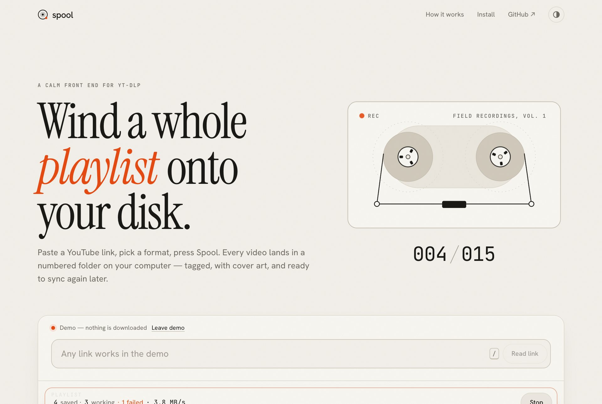
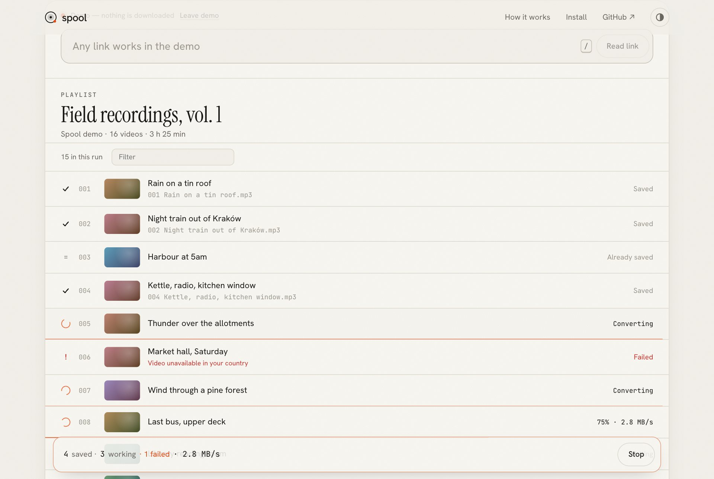

<div align="center">


# Spool

**Wind a whole YouTube playlist onto your disk.**

A calm web interface and a tiny local engine for [yt-dlp](https://github.com/yt-dlp/yt-dlp).
Paste a link, pick MP3, M4A or MP4, press Spool — every video lands in a numbered, tagged folder on your computer.

[**getspool.vercel.app**](https://getspool.vercel.app) · [getspool.web.app](https://getspool.web.app) · [Try the demo](https://getspool.vercel.app/#app)

<picture>
  <source media="(prefers-color-scheme: dark)" srcset="docs/hero-dark.jpg" />
  
</picture>

</div>

## Quick start

```bash
# 1. yt-dlp and ffmpeg (macOS shown; see below for Windows and Linux)
brew install yt-dlp ffmpeg

# 2. start the engine — it opens Spool in your browser
npx https://getspool.vercel.app/spool-2.0.0.tgz
```

Needs Node 20 or newer. Files go to `~/Downloads/Spool/<playlist>/001 Title.mp3`.

| OS | Tools |
| --- | --- |
| macOS | `brew install yt-dlp ffmpeg` |
| Windows | `winget install yt-dlp.yt-dlp Gyan.FFmpeg` |
| Linux | `pipx install yt-dlp && sudo apt install ffmpeg` |

## What it does

<picture>
  <source media="(prefers-color-scheme: dark)" srcset="docs/run-dark.jpg" />
  
</picture>

- **Playlists, videos, albums, channels.** Up to 2,000 videos per run. Untick what you don’t want; shift-click selects a range.
- **MP3** (320/192/128 kbps), **M4A** (original audio, no re-encode) or **MP4** (best, 1080p … 360p).
- **Tagged and tidy.** Title, artist and cover art are embedded. Files are numbered in playlist order.
- **Resumable.** Each folder keeps a `.spool-archive`, so running the same playlist later only fetches what’s new.
- **Patient.** Three downloads at a time, each retried up to three times, with the reason shown if it still fails.
- **Live.** Per-file progress and speed over Server-Sent Events; the tab title shows `(42/182) Spool`.
- **Private.** No accounts, analytics or servers in the middle. The engine has zero npm dependencies.

## How it fits together

```
 browser ──────────────► getspool.vercel.app / getspool.web.app   (static site)
    │
    └── http://localhost:7317 ──► spool engine (Node, on your machine)
                                     └── yt-dlp + ffmpeg ──► ~/Downloads/Spool
```

The website is static and hosted on Vercel and Firebase. The work happens in the engine, a ~700-line Node server that only
listens on `127.0.0.1`, only answers requests addressed to `localhost` (blocks DNS rebinding), and only accepts browser requests
from the Spool sites or `localhost` pages. It also serves the same web app itself at `http://localhost:7317`, so it works with no
internet connection to the site at all.

Why not a hosted downloader? YouTube blocks most cloud servers, long downloads don’t fit serverless time limits, and every file
would detour through someone else’s machine. Running locally fixes all three.

> **Safari:** Safari doesn’t let websites reach `localhost`. Use the window the engine opens, or Chrome, Edge, Arc or Firefox.
> Chrome may ask once to allow access to your local network — that’s the engine.

### Engine options

```bash
npx https://getspool.vercel.app/spool-2.0.0.tgz --dir ~/Music/YouTube   # save elsewhere
npx https://getspool.vercel.app/spool-2.0.0.tgz --concurrency 5         # 1–8 at once (default 3)
npx https://getspool.vercel.app/spool-2.0.0.tgz --port 7400             # then open the site with ?port=7400
npx https://getspool.vercel.app/spool-2.0.0.tgz doctor                  # check yt-dlp and ffmpeg
```

`--no-open` skips opening the browser; `--allow-origin <url>` lets another site you host talk to the engine.
`SPOOL_YTDLP` and `SPOOL_FFMPEG` point at specific binaries.

If downloads suddenly fail, update yt-dlp (`brew upgrade yt-dlp`). Spool warns when your copy is more than 60 days old.

## Develop

```bash
npm install
npm run dev          # engine on :7317 + Vite on :5317 (proxies /api)
npm test             # engine tests (node:test)
npm run build        # typecheck, build web app to dist/, pack dist/spool-<version>.tgz
npm run assets       # re-render icons and og.png (uses system Chrome)
npm run screenshots  # README screenshots; needs `npm run build && npm run engine` running
```

```
engine/        zero-dependency Node engine (CLI, HTTP + SSE server, job queue, yt-dlp glue)
engine/test/   node:test suite
web/           Vite + Preact (React API via preact/compat) + TypeScript, one CSS file
scripts/       pack, dev runner, asset and screenshot renderers
```

**Design.** Bone paper and ink with one signal orange, like a REC light. Instrument Serif for display, Hanken Grotesk for text,
JetBrains Mono for counters, all self-hosted. The cassette deck is drawn live: tape packs are sized by area, so the reels empty
and fill at the right rate, and the smaller one spins faster, as on a real deck. Motion follows Animista’s keyframes
(text-focus-in, fade-in-bottom, shake), with blur-in words and a magnetic primary button after React Bits, a uiverse-style focus
sweep on the link field, and a static grain overlay. All of it switches off under `prefers-reduced-motion`.

## Deploy

- **Vercel** project `getspool` builds `main` on every push → https://getspool.vercel.app
- **Firebase Hosting** (`getspool-app` project, site `getspool`) is deployed by [`.github/workflows/ci.yml`](.github/workflows/ci.yml) on
  pushes to `main` → https://getspool.web.app. It needs the `FIREBASE_SERVICE_ACCOUNT_GETSPOOL_APP` repository secret.
- **Releases:** bump `version` in `package.json`, update the version in the README, tag `vX.Y.Z` and push the tag. CI attaches
  `spool-X.Y.Z.tgz` to a GitHub release; both sites also serve it at `/spool-X.Y.Z.tgz`.

## Formerly PlaylistHydra

Spool is a rebuild of PlaylistHydra, which ran yt-dlp on a Railway server and zipped files back to the browser. That deployment is
retired; the new architecture needs no paid server.

## Use it responsibly

Spool is a front end for yt-dlp and YouTube’s terms still apply. Only download what you have the right to keep: your own
uploads, Creative Commons or public-domain work, or where the creator allows it.

## License

[MIT](LICENSE) © Pranav Dwivedi
